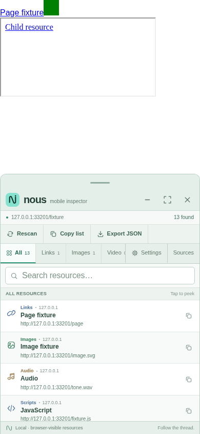
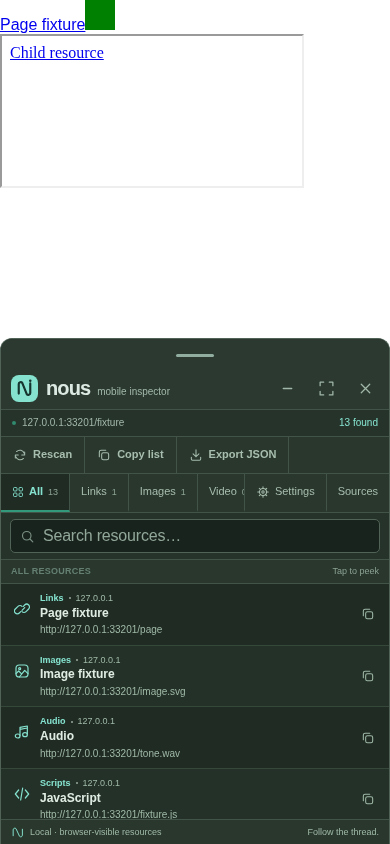
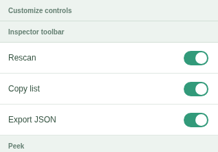
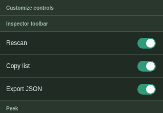
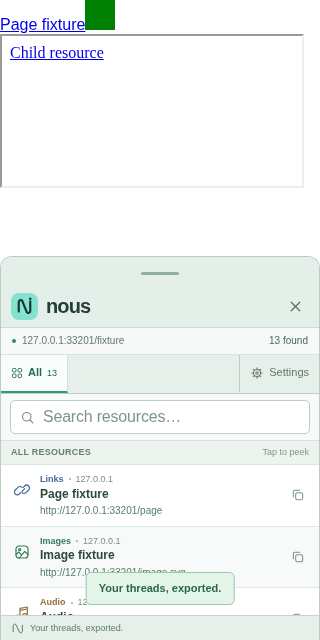
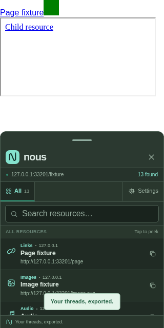

# Nous 1.6 — Personalize validation

Your tools. Your workspace. Follow the thread.

## Baseline and implementation

The maintained baseline is main commit
`71ac52b55ff07253ce96517b7be8691df040ff7f`, after merged PRs #1 (cleanup), #2
(Trace) and #3 (Sources/restricted previews). Its source and exports identify as
1.5. No published stable GitHub Release was found; an older unpublished Trace
draft remains untouched. Version 1.6 is therefore appropriate for the next
feature candidate. All ordinary baseline regressions and both existing browser
suites passed before changes. A full working-tree snapshot and a Git archive of
that revision were retained outside the checkout for rollback.

Personalize adds 17 explicit boolean visibility preferences to the existing
`__nous_preferences_v1` object. Each defaults true. Sanitization accepts only
known own boolean fields and copies the default map; malformed/missing fields
remain visible. Existing preference defaults and the storage key are unchanged.
Unknown keys cannot hide Settings, All, either Close control, Open or Back.
Storage remains website-local and gracefully falls back to the current session.

The new Customize controls section reuses existing Settings groups, rows,
labels and switches. No CSS or icons were added or changed. Applying visibility
updates existing controls and cached tab nodes. An empty optional toolbar collapses. A hidden
selected category returns to All, including when restored from history; the
query and collected records remain intact. Hidden categories still participate
in All/search/export. Hiding active Sources returns to resources without HTML
serialization. Inspect this page combines its preference with the existing
webpage-context condition. Existing view transitions remain; visibility changes
themselves do not reload or replace active media. Reset settings restores the
complete visibility map using the existing reset action and retains history.

No scans, observers, polling, requests, dependencies, permissions, profiles,
cross-site sharing or new inspection capabilities were introduced. The explicit
flags keep the implementation proportional to this release. Reordering, custom
actions and Sources search remain deferred as requested.

## Test outcomes

Node.js 24.22.1, Chromium 156 and Python 3.12 on Linux were used.

- Existing core, discovery, settings/touch, inspection-history, refinement and
  entrypoint suites pass. Refinement reports 25 checks and zero failures.
- Entry-point interactions pass for readable source, bookmarklet and embedded
  preview, including JSON export version 1.6. All 96 existing Trace checks pass
  across those same three modes.
- New Personalize unit suite: 24 passing checks covering legacy/malformed values,
  defaults, storage denial, conditional inspection, hidden controls/categories,
  empty toolbar, protected actions, repeated changes and reset.
- New rendered suite: 47 passing scenarios in light/dark themes. Covers individual
  toolbar controls, all toolbar controls hidden, hidden category selection, all
  optional categories hidden, complete All/search/exports, Sources hidden and
  restored (including active Sources), Minimize/Maximize, protected controls,
  keyboard focus exclusion, reset, repeated toggles, closing/reopening, genuine
  shared-context cross-origin storage separation, blocked storage, older values,
  active audio playback, conditional Peek controls, history and rapid selections.
  Reset/history/Back also restore a previously selected now-hidden category to All.
- All optional controls can be hidden together while Settings, Close and All
  remain available and resources remain usable at 280×320 CSS pixels. Interaction
  cases also use 320×640; default comparisons cover the sizes below.
- Current preservation comparison against maintained 1.5 passes: every original
  preference default; complete UI markup/CSS after removing only the added
  Settings rows; scanner; inspection/history; cleanup; geometry; gestures; Sources
  serialization/highlighting; safe blocked-preview fallback; Trace/Peek except
  the explicit inspection visibility condition; brands; and outer demo HTML.
- Distribution payload equality and syntax pass. The bookmarklet and preview
  embed the final readable implementation. The only changes to old unit fixtures
  provide the new default preference context or expect version 1.6; existing
  interaction assertions were retained.
- Existing Sources/restricted-preview and Trace browser suites pass. Packaging
  with a baseline also exercises the existing Peek geometry comparisons.
- The archive builds twice identically; extracted checksums verify and an archive
  rebuilt from extracted contents is byte-identical. README GFM rendering and
  repository-relative Markdown links pass.

The legacy whole-UI freeze comparisons describe older release contracts that
predate this explicitly requested Settings addition. The Sources preservation script likewise expects the revision before Sources
was added, rather than this maintained baseline. These scripts are retained unchanged
and invoked in their documented no-baseline mode, where they explicitly skip.
They are not counted as passes. Packaging without a baseline reports seven
conditional comparison/benchmark skips; with maintained 1.5 supplied, the Personalize
preservation suite and paired discovery check run. Current scanner, Peek and preference benchmarks
were also executed separately against retained 1.5, with results recorded below.
No feature test is replaced with a trivial check or disabled.

## Visual findings

Six default closed-Settings captures match the maintained baseline byte for byte
(zero differing pixels): light and dark at 390×844, 320×420 and 280×320 CSS pixels.
The fixture supplies a data favicon so asynchronous favicon discovery cannot
create unrelated resource-count differences. This compares equivalent inputs,
not screenshots with changed counts hidden or masked. Settings intentionally
adds the requested rows and remains scrollable; hidden-control layouts use the
existing flex layout and hidden attribute. No default spacing or style changed.

| Default light | Default dark |
| --- | --- |
|  |  |

| Customize controls | Dark customize controls |
| --- | --- |
|  |  |

| All optional controls hidden | Dark minimal view |
| --- | --- |
|  |  |

These are controlled Linux Chromium fixtures, not physical iPhone screenshots.

## Size and measured cost

Byte counts include the bookmarklet's trailing newline. Raw results and methods
are retained in [measurements.json](../../release/personalize/measurements.json).

| Artifact | Maintained 1.5 | Personalize | Increase |
| --- | ---: | ---: | ---: |
| Readable source | 73,903 | 80,004 | 6,101 bytes |
| Bookmarklet | 69,700 | 75,547 | 5,847 bytes |
| Preview HTML | 153,574 | 166,062 | 12,488 bytes |
| Bookmarklet gzip | 19,802 | 20,571 | 769 bytes |

The scanner is byte-identical. Existing synthetic scanner medians (1.5 → 1.6):
1,000 links, first call 3.012 → 3.065 ms and warmed 1.566 → 1.774 ms; 12,000 links,
first call 18.515 → 18.080 ms and warmed 15.411 → 15.479 ms. Peak deduplication
sets remain 1,002 and 2,500. Variation in identical scanner code does not establish
an algorithm improvement or a Personalize scanning regression.

Synthetic image Peek medians were 0.003485 → 0.003481 ms per preview. Synthetic
preference application changed from 0.000102 to 0.002651 ms; a visibility toggle
including sanitization, Settings synchronization and JSON save preparation was
0.023987 ms. Preference measurements use cached synthetic nodes, 20 warmup batches
and 61 alternating batches of 1,000 for the paired comparison. Real DOM/layout,
rendering and storage latency are excluded. No meaningful regression was
demonstrated by these small added UI costs; this is not an iPhone speed guarantee.

## Limitations, reproduction and rollback

Physical iPhone Safari, on-device bookmark installation, native touch and actual
Safari storage/rendering/performance remain unverified. They should be tested
before stable publication. Existing site-specific embedding/CSP and large-page
limitations remain. No live-site compatibility workaround is included.

Run the current package verification:

```sh
python3 release/personalize/package.py /workspace/nous-1.6-rc.1 --browser --baseline /path/to/1.5/Nous_Source.js
```

The baseline directory needs its accompanying preview and brand files. See
[release instructions](../../release/personalize/README.md) for standalone test
commands, deterministic packaging and the exact rollback commit/archive checksum.
Restore the previous bookmarklet from that commit to roll back immediately.
Older code ignores the new visibility field. Main, historical releases and notes
are untouched. The feature PR must not merge automatically, and a final release
requires approval.
