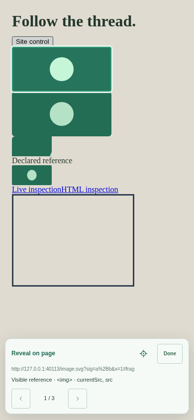
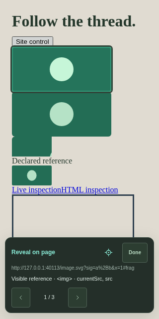

# Reveal on page

Tap **Reveal** beside a resource's row Copy action. Nous moves its panels aside,
briefly outlines an element that references that exact URL, and shows a small
control bar. Previous/Next cycle through shared references; the target button
highlights the current reference again. Done or Escape restores the inspector,
including the selected inspection, search, list position and existing Peek.
Arrow keys work inside the control bar. Page controls remain interactive.

Off-screen or clipped references offer **Scroll to**. Reveal never scrolls by
itself. Hidden elements remain hidden, declarations are labeled, and missing,
changed or removed references get explicit states. A reference is not proof that
an asset rendered, a source candidate was selected, or media is playable.

## Scope and cost

- Match concrete DOM URL attributes, relevant data attributes, currentSrc,
  srcset candidates and inline style URLs using the owning document's base URL.
  Preserve complete queries, encoding and fragments.
- Represent a video/audio source with its owning media element and a picture
  source with its image; merge several observations of the same element.
- Search the active live inspection and accessible embedded documents. A live
  inspected frame is temporarily shown in place, without moving or reloading it.
  HTML-only inspections explain that the live page is required.
- No asset requests, playback probes, script execution, dependencies, polling or
  mutation observers. Scroll to can trigger the website's existing scroll or lazy
  loading behavior, just like manual scrolling.
- Normal scanner code is byte-identical to main at `197cb85`. The floating UI is
  created on the first Reveal tap. Matching and geometry work start on demand.
  Only the selected reference is tracked during the 2.4-second outline; then its
  scroll/resize listeners and pending animation frame are removed.
- Bound work at 20,000 elements across documents, 100 matched elements, 20 accessible
  child frames and depth two. Attribute values above 6,000 characters are skipped.
  Node, match and frame/depth limits are indicated in the controls.

Measurements are in [measurements.json](measurements.json): headless Chromium,
390x844, a 1,000-link fixture, five warmups and 21 alternating launch samples,
including synchronous layout. Launch median was **48.5 ms before / 57.9 ms after**;
normal discovery is unchanged, but parsing, rendering row actions and CSS do have
startup cost. On-demand matching measured **1.3 ms for 1,000 fixture elements** and
**33 ms at the 20,000-element boundary**, where the later target was correctly
omitted and the limit reported. These are desktop fixture measurements, not
physical iPhone timings or a guarantee for arbitrary sites.

The bookmarklet is **96,580 bytes** before its trailing newline, up from 82,961
(**+13,619 bytes**). Gzip comparison: 27,073 vs 23,235 bytes. Gzip is only a size
comparison; installed bookmarks contain the full uncompressed code. No runtime
libraries or new assets are loaded.

## Validation

- `node build.cjs`, syntax checks, `tests/core.cjs`: exact source/bookmarklet/preview
  payload equality and syntax; existing preview routes and panel geometry.
- `tests/reveal.cjs`: exact signed URLs and fragments, bases, source/picture
  deduplication, srcset/style references, blocked frame access, collection bounds,
  hidden/removed/declaration geometry, overflow clipping and scaled frame offsets.
  With `NOUS_BASELINE`, it verifies the normal scanner is byte-identical.
- `tests/reveal-browser.cjs`: 72 controlled checks for each of source, bookmarklet
  and embedded preview at 390x844, 320x640 and 280x320 in light/dark themes. Covers
  no pre-click traversal or floating UI, hidden/shared/off-screen references,
  no asset requests or playback calls from Reveal, explicit scrolling, responsive
  sources, inline backgrounds, declarations, timing-only results, cross-origin
  boundaries, nested-frame coordinates, stale/removed references, fade/tracking
  cleanup, keyboard exit/focus restoration, live inspection/Back, HTML-only
  guidance, closing/relaunching and inert callbacks from a closed instance.
  At 280x320, the existing split Peek is closed before row actions so the list is
  reachable; Reveal also verifies the retained hidden inspection frame.
- Existing discovery, media/fonts, settings/touch, inspection history, refinement,
  Trace, Personalize and all three row-Copy/entry-point suites pass.
- Existing Chromium Trace, Sources/restricted-preview and 47 Personalize browser
  scenarios pass. No historical screenshot-parity comparisons were run.

## Limits and device checks

References inside inaccessible frames, nested shadow roots, player closures,
embedded configuration text or external CSS rules are not mapped to rendered
page elements. A font preload can point to its link declaration; a font file
found only in CSS/timing has no established element match. New references require
Done and another Reveal tap; there is no continuous rescan. Visibility describes
DOM geometry and CSS visibility, not pixel-level occlusion or asset rendering.
Highlights are rectangular; unusual rotations, perspective and nonrectangular
clipping can make their bounds approximate.

Physical iPhone Safari and WebKit automation were unavailable. Check bookmark
installation, touch targets, browser-bar/keyboard and orientation resizing,
safe-area placement, nested scrolling and frame coordinates on the intended
phone. No bookmarklet-size or performance guarantee is made for that device.
The readable source, installable bookmarklet and bundled preview are rebuilt;
historical frozen candidate manifests and releases remain untouched.
